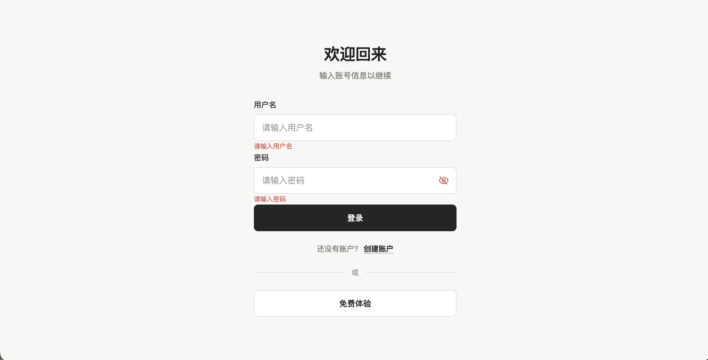
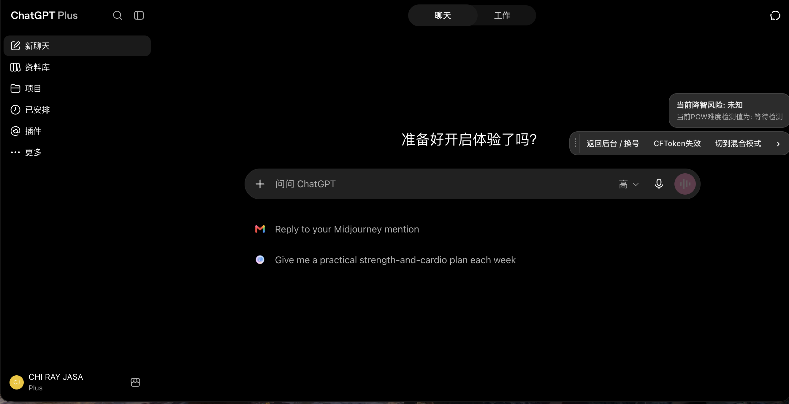
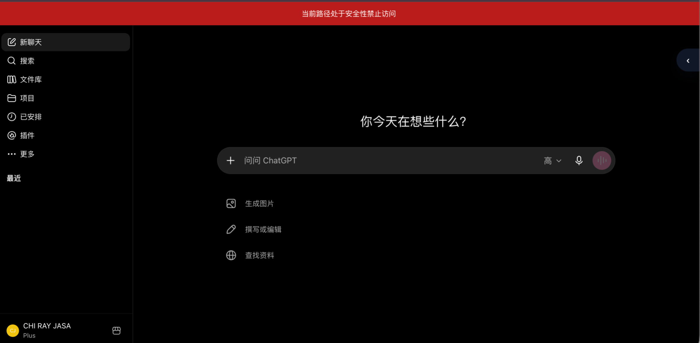
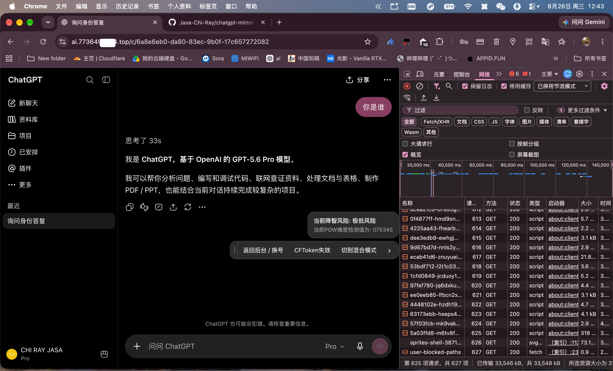
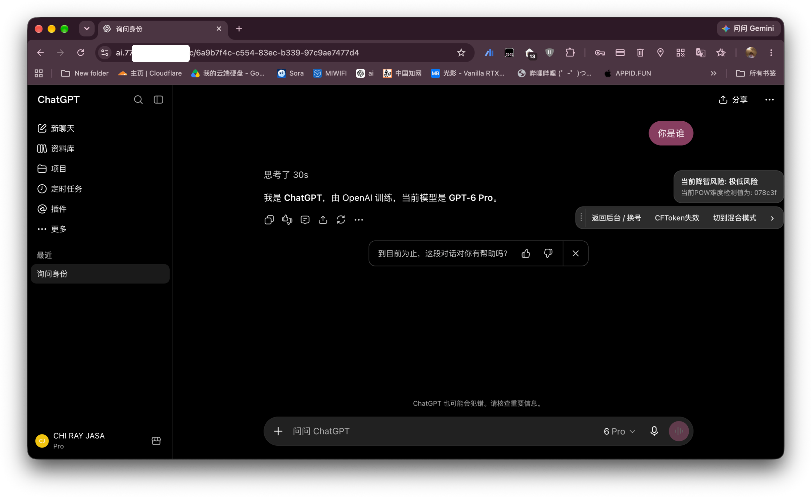
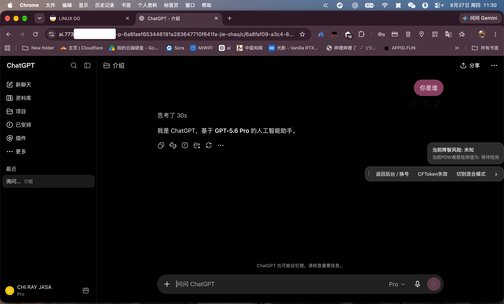
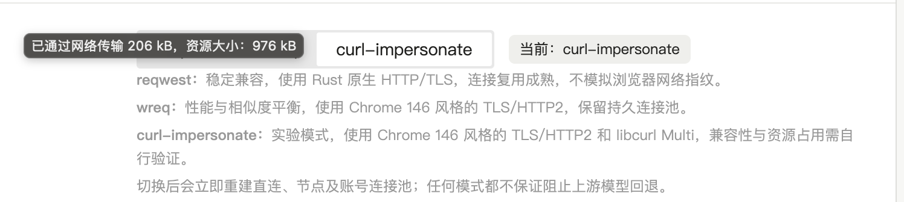
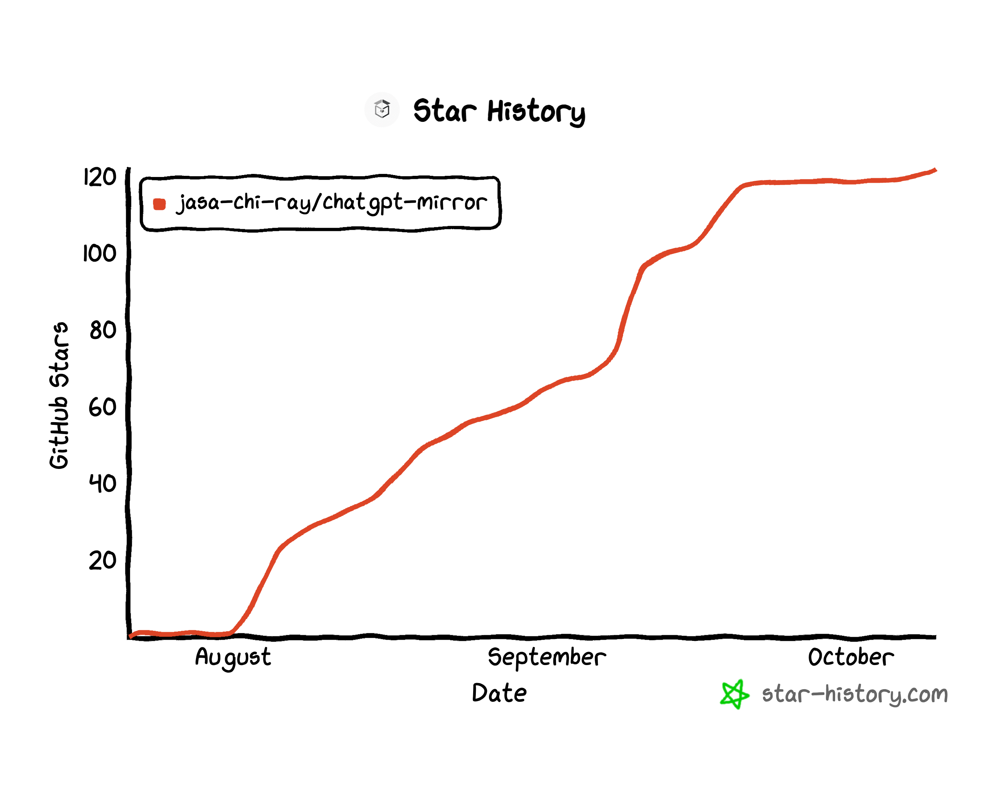

# ChatGPT Mirror

### 仅适合个人学习和个人研究用图，allinone镜像目前不更新，其他不受影响


项目重点关注多用户使用、共享账号隔离、移动端兼容、弱网体验和日常运维，**仅适合个人学习、内部研究及其他获得合法授权的非商业场景。**

---

## 目录

- [技术栈](#技术栈)
- [功能概览](#功能概览)
- [效果展示](#效果展示)
- [cfbypass2.0](#cfbypass20)
- [降智情况各功能兼容情况](#降智情况各功能兼容情况)
- [项目结构](#项目结构)
- [快速开始](#快速开始)
- [管理后台](#管理后台)
- [安全与使用边界](#安全与使用边界)
- [使用许可](#使用许可)
- [更新日志](#更新日志)

## 技术栈

- 管理后台：Vue 3、TypeScript、Vite、Pinia、TDesign Vue Next
- 管理服务：Python、Django 5.1、Django REST Framework
- 数据存储：SQLite
- 部署方式：Docker Compose

## 功能概览

- **用户与权限**：管理用户状态、访问权限、可用模型和使用限制。
- **账号管理**：集中维护 ChatGPT 账号，支持 Cookie 和 Refresh Token 两种录入方式。
- **号池分配**：通过账号池组织可用账号，并按用户分配访问范围。
- **共享账号隔离**：不同镜像用户共用上游账号时，尽可能隔离普通对话、归档、搜索、标题和删除操作 & MCP & skills。支持：**模型隔离**，**模型频率限制**
- **使用记录**：查看访问记录、使用次数和运行状态，便于日常管理与排查。
- **站点配置**：管理代理、连通性测试、自定义脚本和禁止访问路径。
- **多端兼容**：持续适配桌面浏览器、iPhone Safari 和 iPhone Chrome 等访问环境。
- **部署运维**：提供本地及 VPS 的 Docker Compose 编排，便于启动、更新和查看日志。支持通过邮件`SMTP`为定时检测到的已经失效的账号进行邮件推送服务

## 效果展示

### 登录界面



### ChatGPT 界面



### 禁止访问路径



### 操作演示


https://github.com/user-attachments/assets/07069457-27af-4b66-91ec-735703340abf


[▶ 查看演示视频](./imageandvideo/演示1.mp4)

> GitHub 页面无法直接播放视频时，可点击链接查看或下载原始文件。

## cfbypass2.0

**cfbypass 2.0** 采用 **双内核协同机制**。日常请求优先由 **极致轻量请求内核** 处理；遇到明确的脚本验证挑战，或满足自动后备条件时，再启用浏览器执行内核。整个切换过程 **自动完成**，无需手动选择模式。

这种 **按需运行** 的方式减少了浏览器长时间驻留带来的 **资源开销**。浏览器可以在任务之间复用，空闲后自动关闭，再次需要时重新启动，兼顾响应速度与服务器资源使用。

在一次实际部署记录中，轻量内核用时 **约 214 毫秒(0.214 秒)** 完成了 Cookie 获取，服务 **首次预热便成功**。这是单次运行结果，具体耗时仍会受到网络、代理和验证类型的影响。


## 降智情况&各功能兼容情况

<details>
<summary><span style="color: #d4a017; font-weight: bold;">点击此处以查看降智情况及部分检测</span></summary>


### 最新版本降智情况（原生日本 IP）




#### 降智及降智复测


#### GPT-Astra 降智复测



添加项目隔离后降智复测



> 本降智测试已在最新版本中的“代理“界面开启**实验性**的“curl-impersonate“，实验模式造成的后果需自行承担




### GPT6-intelligent-UI


</details>


## 项目结构

```text
chatgpt-mirror/
├── backend/                 # 管理服务
├── frontend/                # 管理后台
├── imageandvideo/           # README 图片与演示视频
├── docker-compose.yml       # VPS 部署编排
└── FAQ.md                   # 常见问题
```

> 非开源组件未在项目结构中展开。

## 快速开始

### 环境要求

- Docker Engine
- Docker Compose v2
- 可用的 HTTPS 域名（生产环境推荐）

### 配置与启动

先在项目根目录复制示例配置：

```bash
cp .env.example .env
```


然后编辑 `.env`，至少替换以下示例值：

```env
ADMIN_USERNAME=admin
ADMIN_PASSWORD=请替换为管理员强密码

GATEWAY_ADMIN_SECRET=请替换为独立随机密钥
DJANGO_SECRET_KEY=请替换为独立随机密钥
CREDENTIAL_ENCRYPTION_KEY=请替换为至少32位的独立随机密钥

DJANGO_ALLOW_ALL_ORIGINS=disable
DJANGO_ALLOWED_HOSTS=example.com,django,localhost,127.0.0.1
DJANGO_CSRF_TRUSTED_ORIGINS=https://example.com
LOCAL_NETWORK_ACCESS=disable

CLOUDFLARE_TURNSTILE=disable
CLOUDFLARE_TURNSTILE_SITE_KEY=
CLOUDFLARE_TURNSTILE_SECRET_KEY=
```

需要直接通过 `http://localhost:端口` 或 `http://局域网IP:端口` 访问时，可设置：

```env
LOCAL_NETWORK_ACCESS=enable
```

该开关会让 Gateway 允许任意 Django Host/Origin/Referer，并强制关闭
`DJANGO_SESSION_COOKIE_SECURE`、`DJANGO_CSRF_COOKIE_SECURE` 和 `COOKIE_SECURE`，因此不需要再分别设置这三个变量。
CSRF token 和登录鉴权仍然保留。此模式允许 Cookie 经明文 HTTP 传输，理论只应在可信本地或局域网使用；公网 HTTPS 部署须保持 `disable`。
除 `enable`、`disable` 外的值会导致服务拒绝启动。


请勿将真实密码、Cookie、Token 或 `.env` 文件提交到版本库。


常用命令

```bash
docker compose ps
docker compose logs -f
docker compose down
```

### 使用 NGINX/Cloudflare 时记得开启 websocket 支持。并且 NGINX 要求填入以下内容，实现最大化的减少错误
### 错误出现
##### (400 Request Header Or Cookie Too Large、414 Request-URI Too Large)&(upstream sent too big header while reading response header from upstream)

### 解决方案：

``` 
proxy_buffer_size 128k;
proxy_buffers 8 128k;
proxy_busy_buffers_size 256k;
large_client_header_buffers 8 64k;
client_header_buffer_size 64k;
```

### 进入 ChatGPT 后页面无限刷新（refresh_account 循环）

##### 现象

进入 ChatGPT 后页面每隔几秒自动刷新一次，发送按钮一直转圈，无法发送消息。浏览器里可以看到反复跳转到
`/?refresh_account=true&startup_account_refresh=true`，控制台反复出现 `[gw] cleaned URL`。

##### 原因

ChatGPT 前端在启动时会比较 SessionToken 里的账号信息（`session.account.planType` / `isDelinquent` / `gracePeriodId`）
和 `/backend-api/accounts/check` 的返回值。两者不一致时（例如 SessionToken 里是 `go`，`accounts/check` 返回 `plus`），
会执行 `window.location.replace("/?refresh_account=true&startup_account_refresh=true")` 刷新一次。
带着这两个参数加载的页面不会再次触发刷新（前端自带的防循环保护）。

但目前 Gateway：

1. 对 `/?refresh_account=true...` 返回 302 跳回 `/`，参数丢失；
2. 注入的脚本在 ChatGPT 读取参数之前执行 `history.replaceState` 把参数清掉（`[gw] cleaned URL`）；
3. 注入的 `suppressRefreshAccountNavigation` 拦截不到 `window.location.replace`（浏览器不允许覆盖该方法）。

结果前端永远读不到参数，防循环保护失效，页面无限刷新。

##### 临时解决方案（NGINX）

在反代的 `location /` 中加入以下内容：把带参数的请求按 `/` 转给 Gateway，但浏览器地址栏保留参数；
并让注入脚本不再清除参数。页面只会额外刷新一次，之后正常使用。

```nginx
location / {
    if ($arg_startup_account_refresh = "true") {
        rewrite ^/$ /? break;
    }
    proxy_pass http://127.0.0.1:40002;

    # sub_filter 需要未压缩的响应
    proxy_set_header Accept-Encoding "";
    sub_filter_once off;
    sub_filter "window.history.replaceState(null, '', clean || '/');" "void 0;";

    # ...其余 proxy_set_header / websocket 配置保持不变
}
```

`sub_filter` 依赖注入脚本的原文，Gateway 更新后如果脚本内容变化需要同步调整。


## 管理后台

登录后可以使用以下管理功能：

| 功能 | 说明 |
| --- | --- |
| 用户管理 | 维护用户状态、访问权限、使用限制 |
| ChatGPT 账号 | 添加、更新和检查账号状态，并在需要时手动刷新凭据 |
| 号池管理 | 对账号进行分组，并配置账号池与镜像用户的关联关系 |
| 访问日志 | 查看用户访问记录和运行情况，辅助定位异常问题 |
| 代理管理 | 维护代理配置并执行连通性测试 |
| 脚本管理 | 维护站点所需的自定义脚本配置 |
| 访问限制 | 配置不允许镜像用户访问的页面或功能范围 |


## 安全与使用边界

- 仅在你拥有授权的账号、网络和部署环境中使用本项目。
- 使用者应自行遵守 OpenAI 服务条款及所在地法律法规。
- 不要共享账号凭据、访问令牌、Cookie 或其他敏感信息。
- 生产环境应使用独立强密钥和 HTTPS，并限制管理端的网络暴露范围。
- 共享账号隔离只作用于镜像站可控制的范围，不能替代上游账号本身的安全隔离。
- 上游页面和接口可能变化；本地测试通过不代表部署后的浏览器流程一定可用。
- 管理员进行任何用户操作（包括但不限于权限，密码）都可能导致正在使用的用户掉线！

## 使用许可

本项目仅允许用于个人学习、研究及其他非商业用途。禁止将本项目或其修改版本用于收费服务、商业运营、商业部署、转售、托管收费或其他直接或间接营利活动。如需商业使用，须事先取得作者的书面许可。

## 更新日志

### 2026-10

- 添加项目隔离功能
- 添加对 GPT6 系列支持
- 添加对新版 GPT6 系列 和 ChatGPT Intelligent UI
- 减少 GPT6 使用 ChatGPT Intelligent UI 的降智可能
- 优化组件适配性
- cfbypass-2.0提供了适用于 Cloudflare turnstile 的更快的处理方案（需要更新 [docker-compose.yml](./docker-compose.yml) ）
- 修复refresh_account 无限刷新问题（由github/Cznorth提出）
- 修复少许 team 账号所导致的问题（由github/I0amLK提出）
- 修复多标签页多开互踢问题（由github/asdfank提出）


### 2026-09

- 增加大量安全性功能
- 修复可以通过"//"绕过访问可以看到原始session内容（由github/xiaolongmr提出）
- 复测
- 修复错误
- 修复错误 x 2
- MCP & skills 隔离
- 添加：**模型隔离**，**模型频率限制**
- 支持通过邮件`SMTP`为定时检测到的**已经失效的账号进行邮件推送服务**

### 2026-08

- 针对 iPhone Safari 和 iPhone Chrome 偶发请求失败、页面资源解析警告等现象进行兼容性调整。
- 保持桌面端原有访问行为不变.
- 增加敏感词（主要用于政治内容）机制检测和验证
- 增加新的方案，位于代理界面（reqwest/wreq）
- 优化 bypass 请求
- 优化代理分流
- 添加公告功能
- 细节优化
- 公告支持 markdown
- 增加可信域名直接配置列表（脚本）
- 增加新的实验性最终方案（curl-impersonate）
- 优化降智检测和必要的应对方案
- 大幅度减少 Pro 模型的降智几率


### 2026-07

- 完成一轮安全加固，重点收紧凭据输出、管理权限、跳转边界、敏感日志和生产环境安全配置。
- 增加共享上游账号时的镜像用户隔离，覆盖普通对话、归档、搜索、标题和删除等常用操作，并限制共享记忆功能带来的交叉影响。
- 优化页面静态资源和图表内容的加载表现，减少资源缺失、重复加载和卡片显示异常。
- 修复容器构建过程中偶发的依赖缓存与产物缺失问题，提高重复构建的稳定性。

### 2026-06

- 增加凭据定时更新、并发保护、立即刷新和剩余有效时间展示，降低凭据过期造成的中断。
- 持续修复移动端对话加载和实时连接兼容问题

### 2026-05 及以前
- 开发


## Star History


