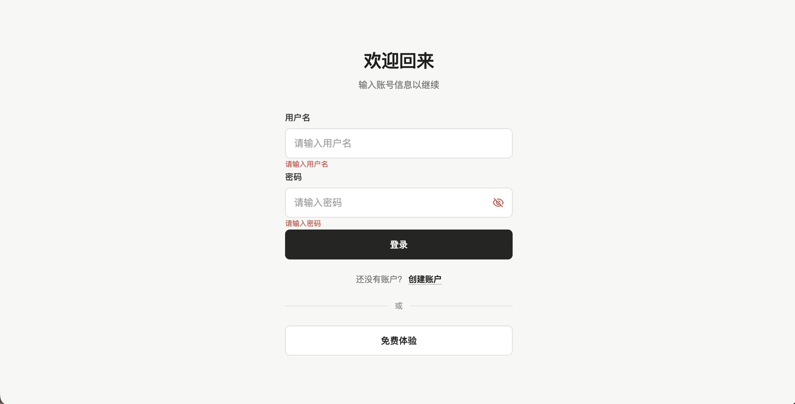
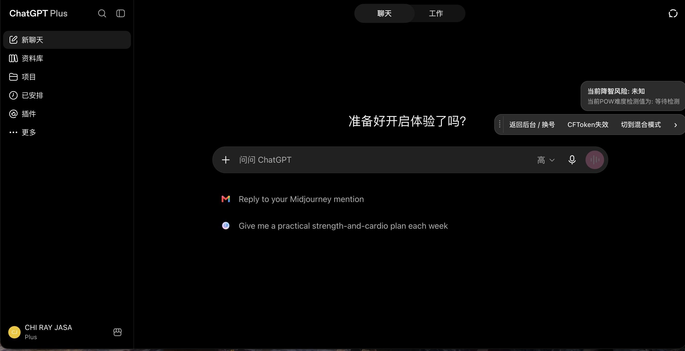
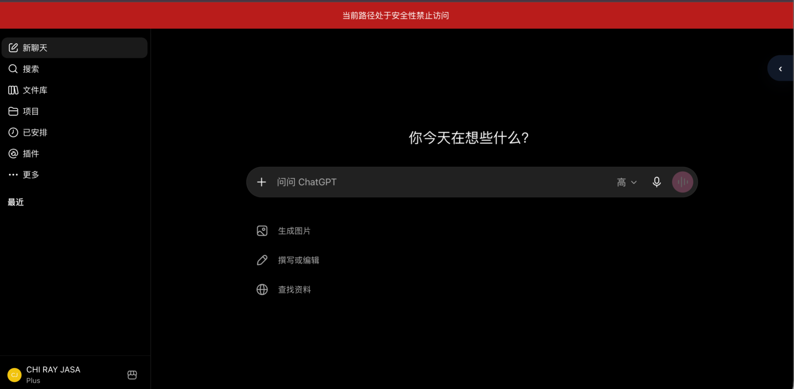
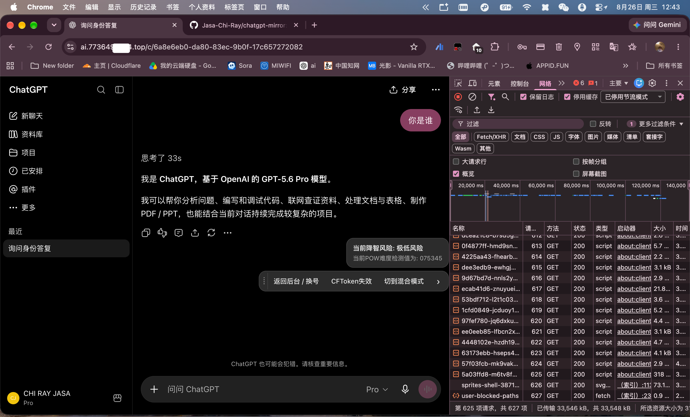
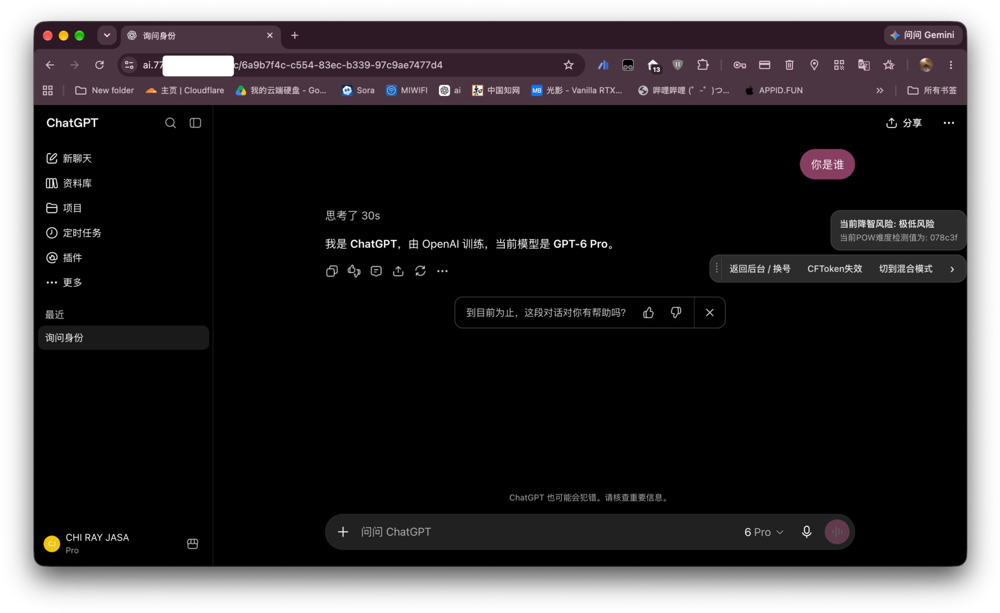
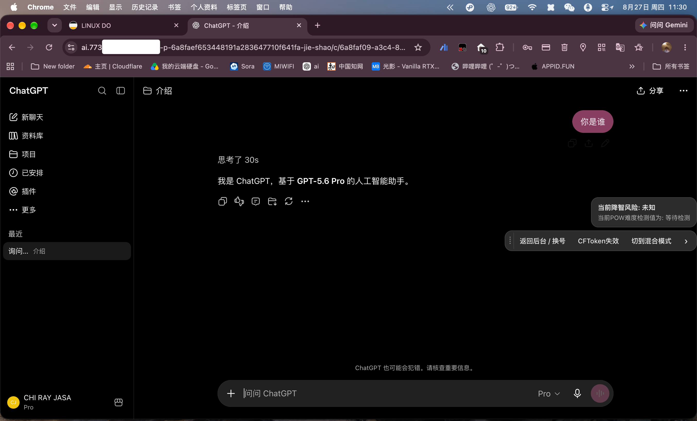
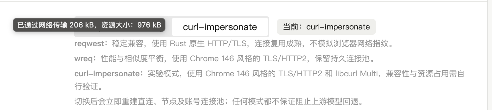
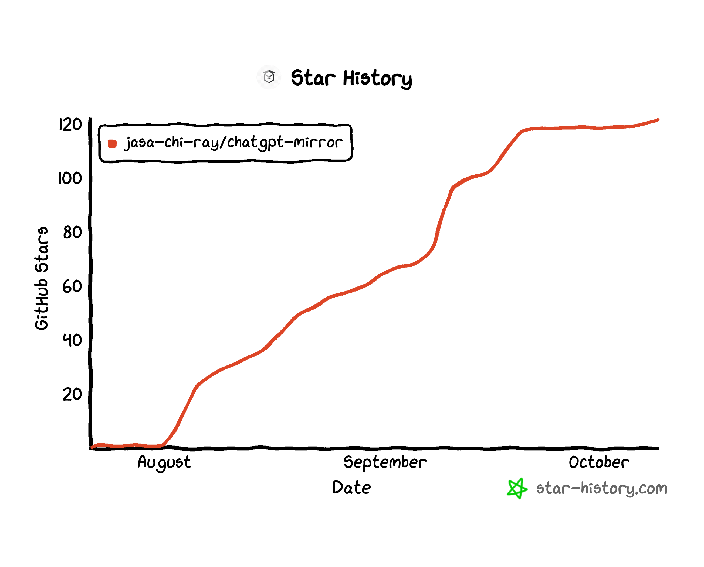

# ChatGPT Mirror

### 适合个人学习和研究使用。

# **项目恢复更新，本次重点优化性能，并对登录界面和管理后台进行大幅改版。**

本次更新继续完善 ChatGPT 新版页面和接口的兼容性，同时优化网关、CF 辅助和资源加载流程。登录、账号选择和管理后台统一了配色与交互，支持中英文切换和深色、浅色模式。

目前使用 Docker Compose 部署，三个服务均从云端拉取镜像，支持 **AMD64 / ARM64**，不需要在服务器上编译。网关及 CF 辅助暂未完整开源，部署以云端镜像为准。

## 本次更新

### 性能提升

- **减少浏览器开销**：cfbypass 优先使用轻量请求内核，需要执行 JavaScript 时再启动浏览器。浏览器进程可复用，空闲后自动释放。
- **减少首次请求等待**：CF Cookie 预热在后台执行，普通 HTTP 和 WebSocket 请求不主动启动验证浏览器。
- **减少重复请求**：网关复用连接与授权缓存，DIL 资源按上游缓存策略加载，降低重复获取资源的开销。
- **完善流式响应**：适配新版回答组件和云端 DIL，修复部分账号出现“无法加载回复”、刷新后历史回答不显示的问题。

### 界面大幅优化

- 重新设计登录页、注册入口和账号选择页面，统一字体、间距与配色。
- 重构管理后台的导航、表格和表单，让账号、用户、号池和日志更容易查找。
- 添加中英文切换与深色、浅色模式，登录页和后台使用同一套视觉风格。
- 优化账号套餐标识、状态提示和操作反馈，登录冷却提供剩余时间倒计时。

### 兼容与功能修复

- 修复 **Pro 被识别成 Free** 的问题，覆盖标准 Pro、Pro Lite、Pro Max 及相关订阅类型；凭据检测失败时保留上次有效套餐。
- “访问与安全”新增 **禁止访问 Dot** 独立开关，默认开启，同时控制页面、接口及属于 Dot 的消息房间。
- 完善 **Library 文件隔离**，按用户核对文件归属，覆盖列表、搜索、预览、下载和删除；入口是否隐藏单独配置。
- 适配新版退出登录流程，补充退出、撤销和会话清理处理。
- 页面初始化隔离失败时，提供 **5 秒倒计时**，清理镜像站 Cookie 后自动刷新。
- 完善登录失败记录和 **120 秒冷却**，已登录的有效会话继续可用；同一 NAT 下的其他用户不会仅因 IP 相同被冷却。
- 调整日志输出，保留异常和访问记录，隐藏参数值及 Cookie；改善反向代理后的来源 IP 识别。

## 功能概览

- **账号与号池**：管理上游账号、凭据状态和代理节点，按号池为用户分配账号。
- **文件与会话隔离**：按镜像用户管理对话、项目和 Library 文件，检查预览、下载、删除与搜索归属。
- **界面与交互**：统一登录和后台配色，支持中英文、深色与浅色模式。
- **访问与安全**：集中管理上游设置和 Dot 访问，记录登录失败并提供冷却倒计时。
- **日常运维**：查看用量和访问日志，执行账号检测，并通过 SMTP 接收账号失效通知。

## 效果展示

### 登录界面

https://github.com/user-attachments/assets/241373b4-d7c2-47e9-b740-58020bcdcf09

新版重新整理了登录流程、账号卡片和状态提示。下面的截图保留作旧版对照。



### 管理后台

https://github.com/user-attachments/assets/19174496-7c4f-4475-a70f-a6345328fde0

账号、号池、日志和访问配置使用统一的导航与布局。

### 语言与深色、浅色模式

https://github.com/user-attachments/assets/9464e301-3715-465d-8673-76ac1a6e1a60

### ChatGPT 界面



### 禁止访问路径



当前版本在“访问与安全”中使用总开关管理上游设置，并提供独立的 Dot 开关；上图为旧版路径管理界面。

### 操作演示

https://github.com/user-attachments/assets/07069457-27af-4b66-91ec-735703340abf

[▶ 查看原版演示视频](./imageandvideo/演示1.mp4)

> 视频可在 GitHub 网页端直接播放。

## cfbypass2.0

**cfbypass 2.0** 采用 **双内核协同机制**。日常请求优先由 **轻量请求内核** 处理；遇到需要执行 JavaScript 的验证，或满足自动后备条件时，再启用浏览器执行内核。整个切换过程 **自动完成**，无需手动选择模式。

这种 **按需运行** 的方式减少了浏览器长时间驻留带来的资源开销。浏览器可以在任务之间复用，空闲后自动关闭，再次需要时重新启动。

在之前的一次实际部署记录中，轻量内核用时 **约 214 毫秒（0.214 秒）** 完成 Cookie 获取，服务首次预热便成功。这是单次运行记录，具体耗时与网络、代理和验证类型有关。

## 降智情况&各功能兼容情况

<details>
<summary><span style="color: #d4a017; font-weight: bold;">点击此处以查看降智情况及部分检测</span></summary>

### 最新版本目前使用第二种或者第三种线路完全不降智，以下为老版本降智情况（原生日本 IP）



#### 降智及降智复测


#### GPT-Astra 降智复测



添加项目隔离后降智复测



> 这组历史测试在“代理”界面开启了 curl-impersonate，截图日期保留，供对照查看。



### GPT6-intelligent-UI


</details>

## 项目结构

```text
chatgpt-mirror/
├── backend/                 # 管理服务：用户、上游账号、号池与健康检测
├── frontend/                # 管理界面：登录、主题与后台页面
├── imageandvideo/           # README 图片与演示视频
├── .env.example             # 环境变量模板
├── docker-compose.yml       # 云端镜像部署编排
├── FAQ.md                   # 常见问题
└── README.md                # 项目说明
```

启动后，`data/` 保存网关数据，`backend/db/` 保存管理服务数据，`backend/logs/` 保存日志。更新时保留这几个目录以及原来的 `.env`。

> 非开源组件未在项目结构中展开。

## 快速开始

### 环境要求

- Docker Engine
- Docker Compose v2
- AMD64 或 ARM64 主机
- 可用的 HTTPS 域名（公网部署使用）

### 配置与启动

先在项目根目录复制示例配置：

```bash
cp .env.example .env
```

然后编辑 `.env`，至少替换以下值。每个密钥分别生成，已有部署继续使用原来的值。

```env
ADMIN_USERNAME=admin
ADMIN_PASSWORD=请替换为管理员强密码

GATEWAY_ADMIN_SECRET=请替换为独立随机密钥
DJANGO_SECRET_KEY=请替换为独立随机密钥
CREDENTIAL_ENCRYPTION_KEY=请替换为至少32个字符的独立随机密钥
```

需要生成随机值时，可以多次执行：

```bash
openssl rand -hex 32
```

当前三种镜像都在同一个仓库中，Docker 会自动选择 CPU 架构：

| 服务 | 镜像 |
| --- | --- |
| 网关与管理前端 | `lisa666520/chatgpt-mirror:latest` |
| 管理服务 | `lisa666520/chatgpt-mirror:backend` |
| CF 辅助 | `lisa666520/chatgpt-mirror:cfbypass` |

检查配置并启动：

```bash
docker compose config --quiet
docker compose pull
docker compose up -d
docker compose ps
```

默认访问 `http://服务器IP:40002/`，后台入口为 `http://服务器IP:40002/admin/`。公网部署时使用自己的 HTTPS 域名。

### 局域网与 HTTPS

示例配置默认允许局域网 HTTP 访问：

```env
BIND_ADDRESS=0.0.0.0
LOCAL_NETWORK_ACCESS=enable
```

`enable` 会放开 Host/Origin/Referer 校验，并自动关闭 Secure Cookie；CSRF Token 与登录鉴权仍保留。需要通过 `http://192.168.x.x:40002` 访问时，直接使用这一配置。

使用域名和 HTTPS 时改为：

```env
LOCAL_NETWORK_ACCESS=disable
DJANGO_ALLOW_ALL_ORIGINS=disable
DJANGO_ALLOWED_HOSTS=example.com,django,localhost,127.0.0.1
DJANGO_CSRF_TRUSTED_ORIGINS=https://example.com
DJANGO_SESSION_COOKIE_SECURE=true
DJANGO_CSRF_COOKIE_SECURE=true
COOKIE_SECURE=true
```

域名替换成自己的。反向代理连接网关的 `40002` 端口，Django 和 CF 辅助通过容器网络通信，不需要另外映射端口。

### 更新

```bash
docker compose pull
docker compose up -d
```

保留原来的 `.env`、`data/` 和 `backend/db/`。**不要在更新时重新生成 `CREDENTIAL_ENCRYPTION_KEY`**，已有凭据需要使用原密钥解密。更新后可在“上游账号”点击“一键检测”，重新检查套餐和凭据状态。

### 常用命令

```bash
docker compose ps
docker compose logs -f --tail 100
docker compose down
```

### 使用 NGINX/Cloudflare

开启 WebSocket 支持，并为流式响应关闭代理缓冲。使用 NGINX Proxy Manager 时，先打开界面中的 WebSocket 支持，再在 Advanced 中按需添加：

```nginx
proxy_buffering off;
proxy_read_timeout 300s;
proxy_buffer_size 128k;
proxy_buffers 8 128k;
proxy_busy_buffers_size 256k;
large_client_header_buffers 8 64k;
client_header_buffer_size 64k;
```

头部缓冲配置用于处理 `400 Request Header Or Cookie Too Large`、`414 Request-URI Too Large` 和 `upstream sent too big header` 等问题。来源 IP 的配置见 [FAQ](./FAQ.md)。

## 管理后台

登录后可以使用以下管理功能：

| 功能 | 说明 |
| --- | --- |
| 用户管理 | 维护用户状态、模型配额、文件隔离和访问期限 |
| ChatGPT 账号 | 添加、更新和检测账号，查看套餐、凭据状态与剩余时间 |
| 号池管理 | 对账号分组，并配置账号池与镜像用户的关联关系 |
| 访问日志 | 查看页面访问、登录失败记录和来源 IP，参数值隐藏 |
| 代理管理 | 维护代理配置并执行连通性测试 |
| 脚本管理 | 维护站点所需的自定义脚本配置 |
| 访问与安全 | 统一控制上游设置，独立控制 Dot 访问 |
| 健康检测 | 定时复检上游账号，通过 SMTP 发送异常通知 |

其他部署和使用问题见 [FAQ](./FAQ.md)。

## 使用说明

仅在拥有授权的账号和环境中使用，并遵守上游服务条款及所在地法律法规。

## 使用许可

本项目仅允许用于个人学习、研究及其他非商业用途。禁止将本项目或其修改版本用于收费服务、商业运营、商业部署、转售、托管收费或其他直接或间接营利活动。如需商业使用，须事先取得作者的书面许可。

## 更新日志

### 2026-11

- 项目恢复更新，本次重点优化性能和界面
- 大幅改版登录、账号选择和管理后台，添加中英文与深色、浅色模式
- 优化 cfbypass 按需启动、进程复用和后台预热流程
- 改用云端 DIL，修复部分回答组件和历史内容加载问题
- 完善 Library 文件隔离与文件预览、下载、删除适配
- 修复标准 Pro、Pro Lite、Pro Max 及相关订阅类型被识别成 Free 的问题
- 访问与安全新增“禁止访问 Dot”独立总开关，默认开启
- 适配新版退出登录、会话撤销与 Cookie 清理流程
- 添加页面初始化失败后的 5 秒倒计时恢复
- 完善登录失败记录、浏览器指纹校验和 120 秒登录冷却
- 优化来源 IP 识别与日志脱敏，减少不必要的日志
- 更新 AMD64 / ARM64 云端镜像，统一使用一个仓库的三个服务标签

### 2026-10

- 添加项目隔离功能
- 添加对 GPT6 系列支持
- 添加对新版 GPT6 系列 和 ChatGPT Intelligent UI
- 减少 GPT6 使用 ChatGPT Intelligent UI 的降智可能
- 优化组件适配性
- cfbypass-2.0提供了适用于 Cloudflare turnstile 的更快的处理方案（需要更新 [docker-compose.yml](./docker-compose.yml) ）
- 修复refresh_account 无限刷新问题（由github/Cznorth提出）
- 修复少许 team 账号所导致的问题（由github/I0amLK提出）
- 修复多标签页多开互踢问题（由github/asdfank提出）


### 2026-09

- 增加大量安全性功能
- 修复可以通过"//"绕过访问可以看到原始session内容（由github/xiaolongmr提出）
- 复测
- 修复错误
- 修复错误 x 2
- MCP & skills 隔离
- 添加：**模型隔离**，**模型频率限制**
- 支持通过邮件`SMTP`为定时检测到的**已经失效的账号进行邮件推送服务**

### 2026-08

- 针对 iPhone Safari 和 iPhone Chrome 偶发请求失败、页面资源解析警告等现象进行兼容性调整。
- 保持桌面端原有访问行为不变.
- 增加敏感词（主要用于政治内容）机制检测和验证
- 增加新的方案，位于代理界面（reqwest/wreq）
- 优化 bypass 请求
- 优化代理分流
- 添加公告功能
- 细节优化
- 公告支持 markdown
- 增加可信域名直接配置列表（脚本）
- 增加新的实验性最终方案（curl-impersonate）
- 优化降智检测和必要的应对方案
- 大幅度减少 Pro 模型的降智几率


### 2026-07

- 完成一轮安全加固，重点收紧凭据输出、管理权限、跳转校验、敏感日志和生产环境安全配置。
- 增加共享上游账号时的镜像用户隔离，覆盖普通对话、归档、搜索、标题和删除等常用操作，并限制共享记忆功能带来的交叉影响。
- 优化页面静态资源和图表内容的加载表现，减少资源缺失、重复加载和卡片显示异常。
- 修复容器构建过程中偶发的依赖缓存与产物缺失问题，提高重复构建的稳定性。

### 2026-06

- 增加凭据定时更新、并发保护、立即刷新和剩余有效时间展示，降低凭据过期造成的中断。
- 持续修复移动端对话加载和实时连接兼容问题

### 2026-05 及以前
- 开发


## Star History


